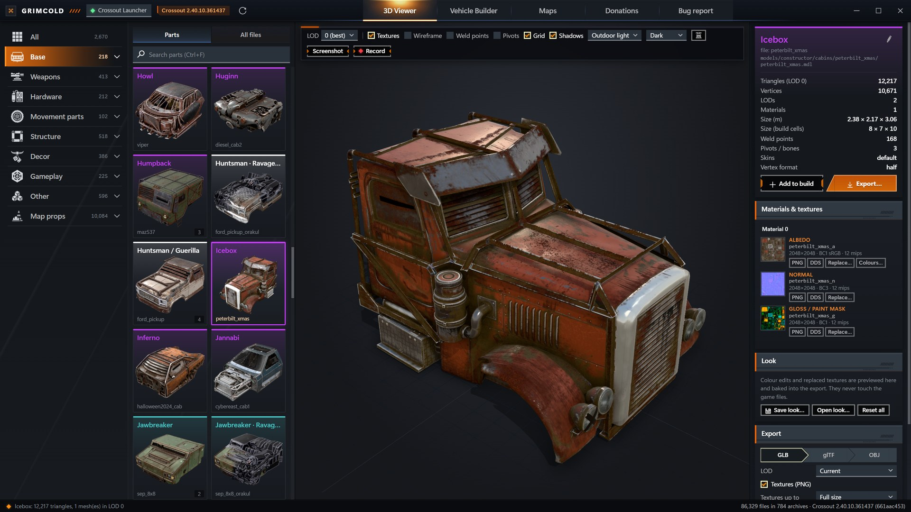
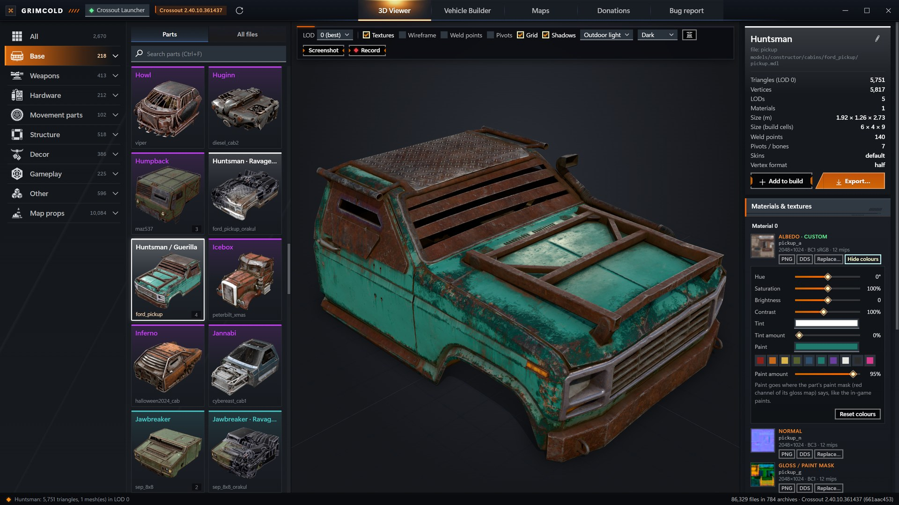
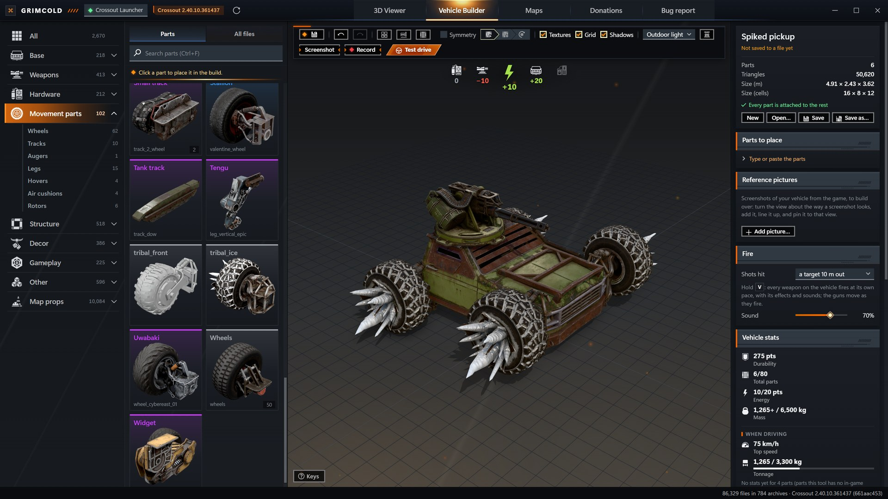
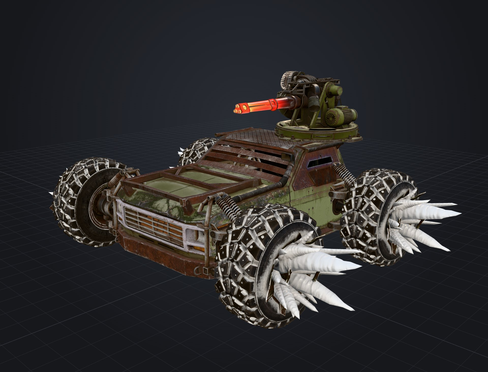
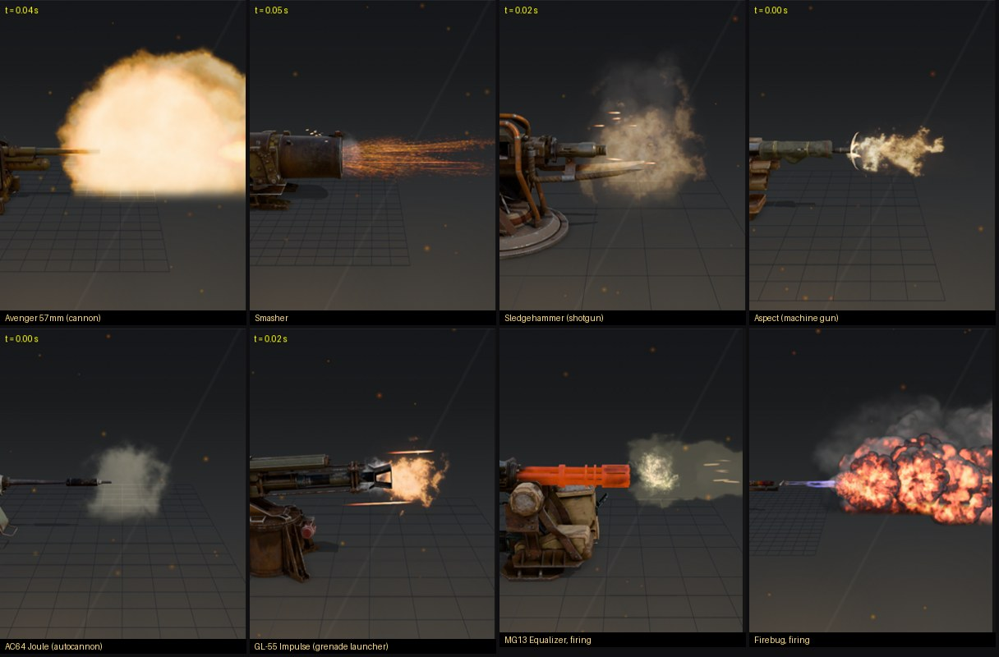

# Grimcold

**An unofficial Crossout toolkit.** Grimcold reads the game's own files and shows every
vehicle part in 3D with its real textures, builds whole vehicles the way the garage does, flies and
drives through the game's maps, fires the guns with their own effects and sounds, and exports parts,
vehicles or whole maps for Blender, Cinema 4D and other 3D tools.

> Unofficial fan tool, not made, endorsed or supported by Gaijin Entertainment or Targem Games. It
> contains no game files: it reads them from your own Crossout installation, never changes them, and
> never touches the running game. Crossout and all of its content belong to Gaijin Entertainment and
> Targem Games ([more below](#the-games-content)).

## Download

1. Download `Grimcold-1.0.3-win64.zip` from the [latest release](https://github.com/Nrnis/Grimcold/releases/latest).
2. Unzip it anywhere, keep its files together, and run `Grimcold.exe`.
3. It finds Crossout by itself (Crossout Launcher or Steam). If it does not, pick the folder that
   holds the game's `data` folder.

You need Windows 10 or 11 (64-bit), a graphics card that runs WebGL 2, the Microsoft Edge WebView2
Runtime (part of Windows 11 and of up-to-date Windows 10; otherwise
[get it from Microsoft](https://developer.microsoft.com/microsoft-edge/webview2/)) and Crossout
installed.

Windows may say "Windows protected your PC", because the app is not code-signed: **More info → Run
anyway**. Only download Grimcold from this repository's Releases.

Settings, builds and logs are kept in `%LOCALAPPDATA%\Grimcold`. To remove the app, delete its folder
and that one.

## What it does

- **3D Viewer**: every part of the game (2,600+ cabins, weapons, modules, wheels, decor and map props)
  with its textures, skins, paints and animations; guns fire with the game's own effects and sounds.
  Recolour, repaint or replace any texture.
- **Vehicle Builder**: put parts together on the game's weld points, with the garage's snapping,
  turning, symmetry and vehicle stats, then take the vehicle for a test drive.
- **Maps**: fly or drive through the game's maps, with their terrain, grass, trees, water, lamps,
  weathers, skies and sounds.
- **Export**: parts, vehicles and whole maps as glTF / GLB or OBJ, textures as PNG or DDS.

| | |
|---|---|
|  |  |
|  |  |

Everything it does, in detail: [MANUAL.md](MANUAL.md). How the game's files are read:
[CROSSOUT_FORMATS.md](CROSSOUT_FORMATS.md).

## Bugs and support

- In the app, **Bug report** copies the technical details and opens this repository's issue form;
  nothing is sent by itself. Please look at the [known issues](KNOWN_ISSUES.md) first.
- [Privacy](PRIVACY.md) · [Security](SECURITY.md) · [Code of conduct](CODE_OF_CONDUCT.md)

## Building from source

Install Visual Studio 2022 with "Desktop development with C++" and run `build.cmd`: it makes
`Grimcold.exe` (and the `build\xotest.exe` checker). `tools\package.ps1` makes the release zip. The
end-to-end tests (`node tools\e2e_all.mjs`) need Node.js and the game installed. More in
[MANUAL.md](MANUAL.md#building).

The parts' stats (`ui/stats.json`) were built with `tools/stats/make_stats.py` from crosscalc.net's
item table; the copied table itself is not part of this repository.

## Licence

Grimcold is free software, © 2026 Nrnis, under the [GNU General Public License v3](LICENSE) with
[additional terms](NOTICE.md). You may use, share and change it. Copies and changed versions must stay
under the same licence with their source, and keep the credit "Grimcold by Nrnis —
https://github.com/Nrnis/Grimcold". Changed versions must say they are changed and must not use the
name Grimcold as their own. It comes with no warranty.

Third-party parts (three.js, the WebView2 SDK, Zstandard, libvorbis' setup headers) keep their own
licences: [THIRD_PARTY_NOTICES.md](THIRD_PARTY_NOTICES.md). Thanks to crosscalc.net for the part
stats and to [CrossoutMarket](https://github.com/Zicore/CrossoutMarket) for the old item data used to
name parts.

## The game's content

Crossout, its name and logo, and all of its game content (models, textures, sounds, maps, effects,
names and texts) belong to Gaijin Entertainment and Targem Games and their licensors. Grimcold's
licence covers only Grimcold's own code and gives no rights to any of it, files exported with
Grimcold included: their use is subject to the rights holders' terms, and sharing, selling or reusing
them without their permission can infringe their copyright.
